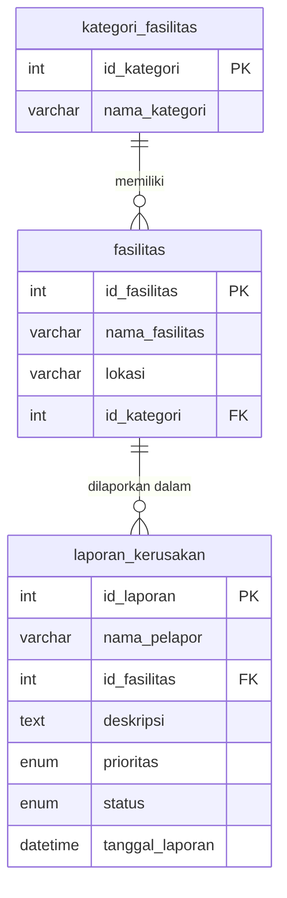

# Sistem Pelaporan Kerusakan Fasilitas

Website CRUD untuk mencatat dan memantau laporan kerusakan fasilitas sekolah
(proyektor, AC, kursi, keran, dan lain-lain). Dibuat dengan **PHP, MySQL, HTML, CSS, dan PDO**.

## Fitur
| Operasi | Halaman | Keterangan |
|---|---|---|
| Create | `tambah.php` | Form laporan baru: pilih fasilitas dari dropdown, divalidasi lalu disimpan |
| Read | `index.php` | Tabel laporan hasil **JOIN 3 tabel** (terbaru di atas) |
| Update | `edit.php`, `ubah-status.php` | Edit seluruh isian, atau ubah status cepat dari tabel |
| Delete | `hapus.php` | Hapus laporan setelah konfirmasi (hanya lewat POST) |

Keamanan dan penanganan kesalahan: semua query memakai *prepared statement*, input divalidasi
(field wajib, panjang maksimal, fasilitas/prioritas/status harus valid), output di-escape
(`htmlspecialchars`), dan setiap aksi menampilkan pesan sukses atau gagal.

## Kebutuhan
- PHP 8.0 atau lebih baru (ekstensi `pdo_mysql` aktif)
- MySQL atau MariaDB
- Browser

## Cara menjalankan
1. Nyalakan MySQL (XAMPP: Start **MySQL**).
2. Impor `database.sql` lewat phpMyAdmin atau DBeaver (jalankan seluruh isinya).
   Ini membuat database `laporan_fasilitas_db` berisi 3 tabel, 26 fasilitas, dan 23 laporan contoh.
3. Letakkan folder project di folder web server (Herd, `htdocs` XAMPP, atau lainnya).
   Alternatif tanpa web server: buka terminal di folder project, jalankan
   `php -S localhost:8000`, lalu buka `http://localhost:8000`.
4. Kalau user atau password MySQL berbeda, ubah di `config/koneksi.php`.

## Struktur file
```
laporan-fasilitas/
├── config/koneksi.php     koneksi database (PDO)
├── src/Laporan.php        semua query SQL (termasuk JOIN) + validasi
├── includes/
│   ├── init.php           session, koneksi, objek $laporan, fungsi bantu
│   ├── header.php         bagian atas halaman + pesan sukses/gagal
│   ├── footer.php         bagian bawah halaman
│   └── form.php           form yang dipakai bersama tambah & edit
├── css/                   simple.min.css (+ lisensinya) dan app.css
├── docs/                  ERD, penjelasan JOIN, template logbook & refleksi
├── index.php              READ
├── tambah.php             CREATE
├── edit.php               UPDATE
├── ubah-status.php        UPDATE (status saja)
├── hapus.php              DELETE
└── database.sql           struktur tabel + data contoh
```

## Database dan relasi antar tabel



| Tabel | Primary Key | Foreign Key | Isi |
|---|---|---|---|
| `kategori_fasilitas` | `id_kategori` | - | Elektronik, Furnitur, Kebersihan & Sanitasi, Bangunan |
| `fasilitas` | `id_fasilitas` | `id_kategori` -> `kategori_fasilitas` | Satu fasilitas di satu lokasi (nama + lokasi unik) |
| `laporan_kerusakan` | `id_laporan` | `id_fasilitas` -> `fasilitas` | Laporan kerusakan; satu fasilitas bisa punya banyak laporan |

Relasi: **satu kategori -> banyak fasilitas**, dan **satu fasilitas -> banyak laporan** (keduanya one-to-many).
Foreign Key memakai `ON DELETE RESTRICT`, jadi kategori atau fasilitas yang masih dipakai tidak bisa dihapus,
dan laporan tidak bisa dibuat untuk fasilitas yang tidak ada.

### Normalisasi sampai 3NF
**Sebelum:** satu tabel laporan menyimpan `nama_fasilitas`, `lokasi`, dan `id_kategori` di setiap baris.
Kalau AC yang sama dilaporkan dua kali, namanya, lokasinya, dan kategorinya ditulis dua kali (redundan, dan mudah
tidak konsisten karena salah ketik). Itu juga ketergantungan transitif: `id_laporan -> nama_fasilitas -> lokasi, kategori`.

**Sesudah:**
- **1NF**: setiap kolom berisi satu nilai (atomik), tidak ada kolom berulang, dan tiap tabel punya Primary Key.
- **2NF**: semua Primary Key hanya satu kolom, jadi tidak ada ketergantungan parsial pada sebagian kunci.
- **3NF**: tiap kolom non-kunci hanya bergantung pada Primary Key tabelnya, bukan pada kolom non-kunci lain.
  `lokasi` dan `id_kategori` bergantung pada `id_fasilitas` (tabel `fasilitas`), dan `nama_kategori` hanya ada di
  `kategori_fasilitas`. Data fasilitas ditulis sekali, laporan cukup menyimpan `id_fasilitas`.

Catatan: `nama_pelapor` disimpan sebagai teks di laporan. Satu orang bisa melapor berkali-kali, tetapi tidak ada
kolom lain yang bergantung pada nama pelapor, jadi tabel tetap memenuhi 3NF. Kalau diperlukan, kolom ini bisa
dipisah menjadi tabel `pelapor` pada pengembangan berikutnya.

### Query JOIN yang dipakai
Halaman `index.php` memanggil `Laporan::semua()` yang menggabungkan 3 tabel:
```sql
SELECT l.id_laporan, l.nama_pelapor, l.prioritas, l.status, l.tanggal_laporan,
       f.nama_fasilitas, f.lokasi, k.nama_kategori
FROM laporan_kerusakan AS l
JOIN fasilitas AS f          ON f.id_fasilitas = l.id_fasilitas
JOIN kategori_fasilitas AS k ON k.id_kategori  = f.id_kategori
ORDER BY l.id_laporan DESC;
```
Penjelasan lengkap dan contoh pertanyaan penguji ada di [`docs/penjelasan-join.md`](docs/penjelasan-join.md).

## Keterbatasan saat ini
Data **fasilitas** dan **kategori** diisi lewat `database.sql` (belum ada halaman kelola). Untuk menambah fasilitas
baru, tambahkan barisnya di tabel `fasilitas`, misalnya:
`INSERT INTO fasilitas (nama_fasilitas, lokasi, id_kategori) VALUES ('Kipas Angin', 'Kelas X RPL 1', 1);`

## Alur singkat
Halaman PHP menerima permintaan -> memanggil method di `Laporan.php` -> method menjalankan query lewat PDO ->
halaman menyimpan pesan, lalu `redirect` ke `index.php` (pola Post/Redirect/Get, supaya refresh tidak mengirim
ulang form).
